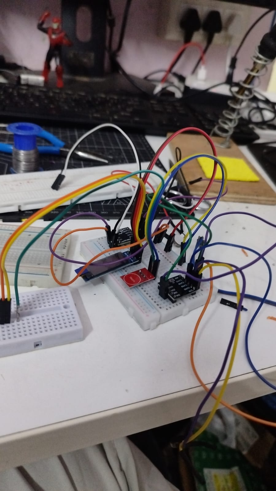

# SixthSense

SixthSense is an experimental Android-to-wearable haptic prototype. A phone
uses its rear camera and on-device ML Kit object detection, maps a detection to
the left, front, or right part of the camera image, and sends a short BLE
command to an ESP32. The ESP32 drives four vibration motors around the head
through two DRV8833 motor-driver boards.

> **Safety boundary:** This is a bench prototype, not a certified mobility
> aid or obstacle-avoidance system. No detected object does not mean a path is
> clear. Test only in a controlled, stationary setting with an accessible
> motor-power switch; it does not replace a cane, guide dog, or attentive
> travel practices.

## Current hardware prototype



The photo shows the current breadboard-stage hardware. Treat it as a working
prototype, not a final wearable enclosure: secure wiring, strain relief,
insulation, motor-current capacity, and an accessible power switch are needed
before any body-worn experiment.

## What the project does

```text
Android rear camera
  -> CameraX frames
  -> on-device ML Kit object detector
  -> haptic policy: zone, persistence, confidence, cooldown
  -> BLE command (L/F/R/B/A/S)
  -> ESP32 BLE server
  -> two DRV8833 boards
  -> left / front / right / back vibration motors
```

- **Motor Test** scans nearby BLE devices, lets you select the ESP32, then
  tests each motor direction manually.
- **Navigation** runs the camera and the on-device detector, then produces
  controlled haptic alerts for image-left, image-centre, and image-right.
- The forward camera deliberately never sends a **back** alert; the back motor
  is reserved for manual testing or a deliberately designed rear-sensor path.

## Repository structure

```text
README.md                              Project overview and setup
project.md                             Original project specification
architecture.md                        Complete hardware/software workflow
docs/images/breadboard-prototype.png   Current hardware prototype photo

android/                               Android Studio project
  app/src/main/java/com/sixthsense/prototype/
    bluetooth/                         BLE protocol, scanner, GATT controller
    camera/                            CameraX lifecycle and preview
    navigation/                        Commands and haptic alert policy
    settings/                          Local DataStore tuning settings
    ui/                                Jetpack Compose screens
    viewmodel/                         UI state and camera/BLE coordination
    vision/                            ML Kit analyzer and image-zone mapping
  app/src/test/                        Unit tests for pure Kotlin logic

firmware/
  esp32_sixthsense/                    ESP32 DevKit firmware and wiring guide
  diagnostics/                         Small BLE checks for isolated debugging
```

## Hardware required

- ESP32 DevKit with an ESP32-WROOM-32D module.
- Two DRV8833 breakout boards (four H-bridge channels total).
- Four vibration motors: left, front, right, and back.
- A motor supply matched to the motors, shared ground, a 10 kOhm pulldown for
  the shared driver `SLEEP/EN` signal, and a 220–470 uF bulk capacitor at the
  driver supply.
- USB cable, breadboard/jumpers for bench tests, and a physical motor-power
  switch.

Never power a motor from the ESP32 3.3 V rail or a GPIO. Connect the ESP32
ground, both driver grounds, and the motor-supply negative terminal together.
The complete wiring map and safety test sequence are in
[architecture.md](architecture.md#3-hardware-architecture).

### GPIO map

| Motor | Driver channel | ESP32 GPIOs |
| --- | --- | --- |
| Left | DRV8833 #1 AOUT1/AOUT2 | 25 (AIN1), 26 (AIN2) |
| Front | DRV8833 #1 BOUT1/BOUT2 | 27 (BIN1), 14 (BIN2) |
| Right | DRV8833 #2 AOUT1/AOUT2 | 32 (AIN1), 33 (AIN2) |
| Back | DRV8833 #2 AOUT1/AOUT2 | 18 (AIN1), 19 (AIN2) |
| Enable | Both driver `SLEEP/EN` inputs | 13, with 10 kOhm pulldown to GND |

## Setup

### 1. Flash the ESP32 firmware

1. Open [`firmware/esp32_sixthsense/esp32_sixthsense.ino`](firmware/esp32_sixthsense/esp32_sixthsense.ino) in Arduino IDE.
2. Install the Espressif ESP32 board package and select the correct ESP32
   DevKit board and serial port.
3. Disconnect motor power for the first upload. Upload the sketch, then open
   Serial Monitor at **115200 baud**.
4. Confirm the log says `Advertising as SixthSense-ESP32`.
5. Attach motor power only after the driver wiring has been inspected and the
   ESP32 and drivers share ground.

The firmware uses the standard BLE library included with the ESP32 Arduino
core; it requires no Wi-Fi, cloud account, or BLE password.

### 2. Build and install the Android app

1. Open the [`android/`](android/) directory in Android Studio.
2. Install Android SDK Platform 35 when prompted. Use Android Studio's bundled
   JDK (17 or newer; JBR 21 is known to work for this project).
3. Connect a physical Android phone with a rear camera and Bluetooth LE, then
   run the `app` configuration.
4. Grant **Camera** permission for Navigation and **Nearby devices** permission
   for BLE scanning/connection. Android 11 and older also require location
   permission and enabled system location services for BLE scanning.

The default application ID is `com.sixthsense.prototype`. To use a different
ID for a separate install, build with
`-PsixthSenseApplicationId=your.package.name`.

### 3. Connect and test BLE

1. Ensure no other BLE app (for example, nRF Connect) is currently connected
   to the ESP32.
2. In the app, open **Motor Test** and tap **Scan devices**.
3. Select `SixthSense-ESP32` from the discovered-device list, then tap
   **Connect selected device**.
4. Wait for **Wearable ready for commands**, then test Left, Front, Right,
   Back, and finally All. Keep **STOP ALL** accessible throughout the test.
5. If the ESP32 is visible in a BLE utility but not in the app, use the
   firmware diagnostic sketches in [`firmware/diagnostics/`](firmware/diagnostics/)
   before changing motor wiring.

BLE pairing in Android's system Settings is not required for this GATT
connection. The app verifies the expected service and command characteristic
after connecting, so selecting a random nearby BLE device will not enable motor
controls.

## BLE contract

| Item | Value |
| --- | --- |
| Peripheral name | `SixthSense-ESP32` |
| Service UUID | `12345678-1234-1234-1234-1234567890ab` |
| Command characteristic | `12345678-1234-1234-1234-1234567890ac` |
| Status characteristic | `12345678-1234-1234-1234-1234567890ad` |
| Commands | One ASCII byte: `L`, `F`, `R`, `B`, `A`, or `S` |

`L`, `F`, `R`, and `B` pulse one motor; `A` pulses all four; `S` immediately
stops every motor. The ESP32 applies a short local pulse and also stops motors
on BLE disconnect or watchdog timeout.

## Further documentation

- [architecture.md](architecture.md) — source-of-truth hardware and software
  workflow, protocol, safety behaviour, and troubleshooting.
- [firmware README](firmware/esp32_sixthsense/README.md) — firmware upload and
  wiring notes.
- [project.md](project.md) — original specification and product context.

## Current limitations

- ML Kit's bundled default model provides broad classifications; it is not a
  comprehensive obstacle detector or distance estimator.
- The camera preview and an absence of detections never indicate a clear path.
- The prototype has not been safety-validated with users or in real travel.
- Confirm the actual motor voltage, stall current, driver-board labels, supply
  capacity, and thermal behaviour before wearable testing.
