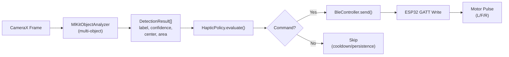

# Detection → Classification → Navigation → ESP32 Pipeline — Complete

## What Was Done

The full vision-to-haptic-to-BLE pipeline is now wired end-to-end. The components implement the requirements from `architecture.md` §7.3 and §10 point 5.

## Pipeline Flow

## Files Changed

### New Files
| File | Purpose |
|------|---------|
| [`HapticPolicy.kt`](android/app/src/main/java/com/sixthsense/prototype/navigation/HapticPolicy.kt) | Pure, unit-testable policy with per-zone cooldowns, persistence, stale timeout, front-first priority |
| [`HapticPolicyTest.kt`](android/app/src/test/java/com/sixthsense/prototype/navigation/HapticPolicyTest.kt) | 10 unit tests covering all policy behaviors |

### Modified Files
| File | Key Changes |
|------|-------------|
| [`DetectionSource.kt`](android/app/src/main/java/com/sixthsense/prototype/vision/DetectionSource.kt) | `enableMultipleObjects()`, `boxAreaRatio` field, unclassified→0.5 confidence floor |
| [`SixthSenseViewModel.kt`](android/app/src/main/java/com/sixthsense/prototype/viewmodel/SixthSenseViewModel.kt) | Replaced inline logic with HapticPolicy, added `zoneCounts`/`commandsSentCount` to UI state |
| [`SixthSenseApp.kt`](android/app/src/main/java/com/sixthsense/prototype/ui/SixthSenseApp.kt) | BLE scan/connect in NavigationScreen, Start gated on connection, zone indicators, detection cards |

## Key Design Decisions (Architecture §7.3)

| Decision | Value |
|----------|-------|
| Object handling | ALL objects treated as obstacles (unclassified get 0.5 confidence) |
| Confidence threshold | 0.40 default (adjustable in Settings) |
| Zone priority | Front-first: CENTER → LEFT → RIGHT |
| Persistence | 2 consecutive frames required before alert |
| Cooldown | 700ms per-zone (adjustable in Settings) |
| Stale timeout | 1500ms — resets all state if no detections |
| BACK command | Never emitted from forward camera |

## Navigation Screen UI

The NavigationScreen now includes:
- **BLE scan/connect controls** directly in the screen (no need to go to Motor Test)
- **Start button gated** on BLE connection (`"Start (connect first)"` when disconnected)
- **Zone indicators**: 3 colored boxes for LEFT / FRONT / RIGHT
  - Gray = no detection
  - Orange = detected, building persistence
  - Red = active alert sent
- **Detection cards** showing label, confidence %, zone, and bounding box area %
- **Scrollable layout** for the expanded content

> [!IMPORTANT]
> Build with **JDK 17** (Android Studio embedded). Host Java 25 is incompatible with Gradle/Kotlin. Open the `android/` folder in Android Studio, ensure the Gradle JDK is set to 17, then build and deploy to a physical device.

## Next Steps
1. Build in Android Studio and deploy to a physical phone
2. Connect the ESP32 wearable from the Navigation screen
3. Point the camera at objects and verify motor pulses fire correctly for each zone
4. Tune confidence threshold and cooldown in Settings based on real testing
5. Test stop/disconnect/error behaviors
